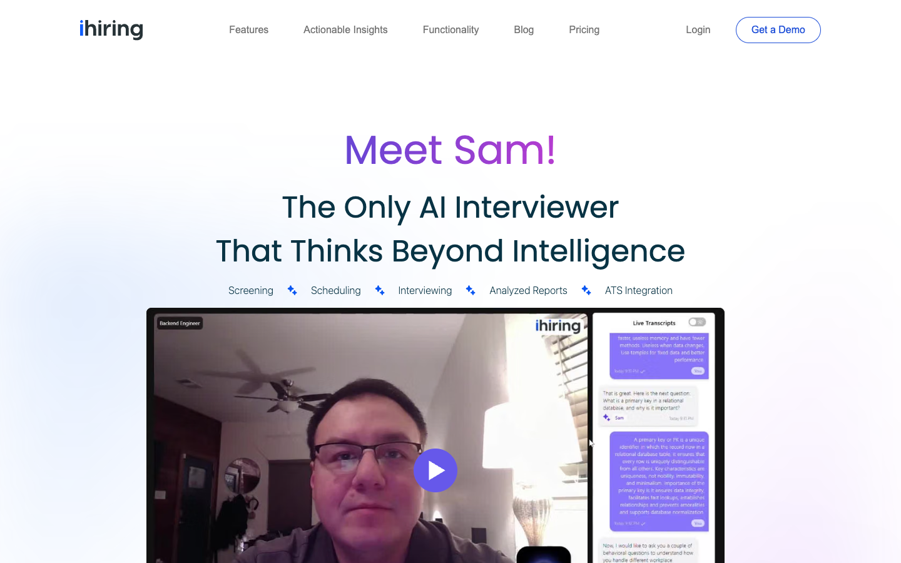
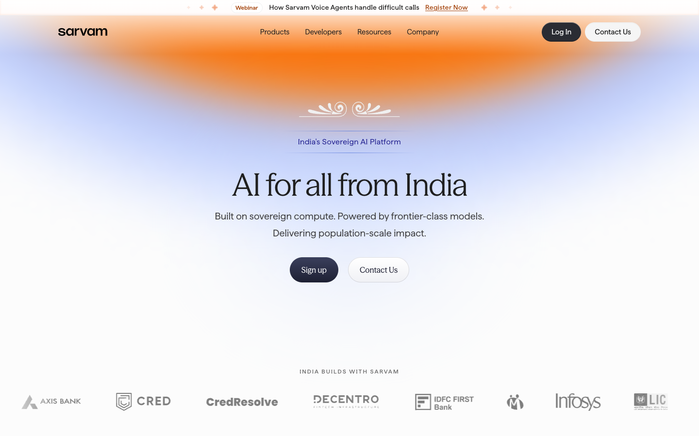
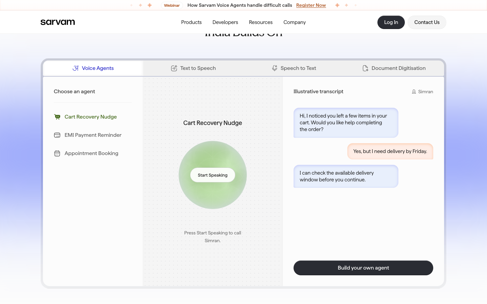
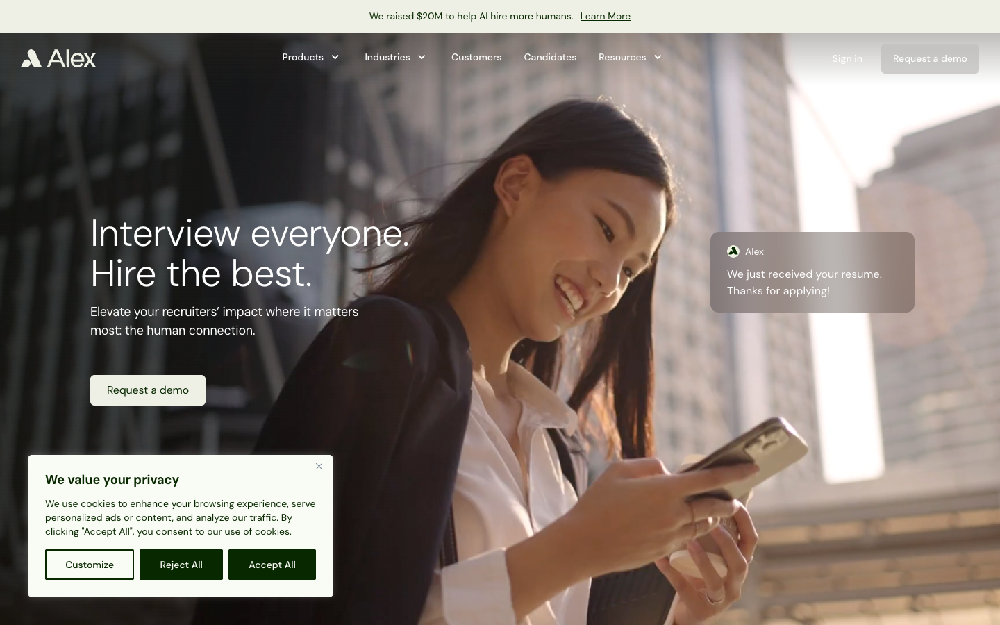
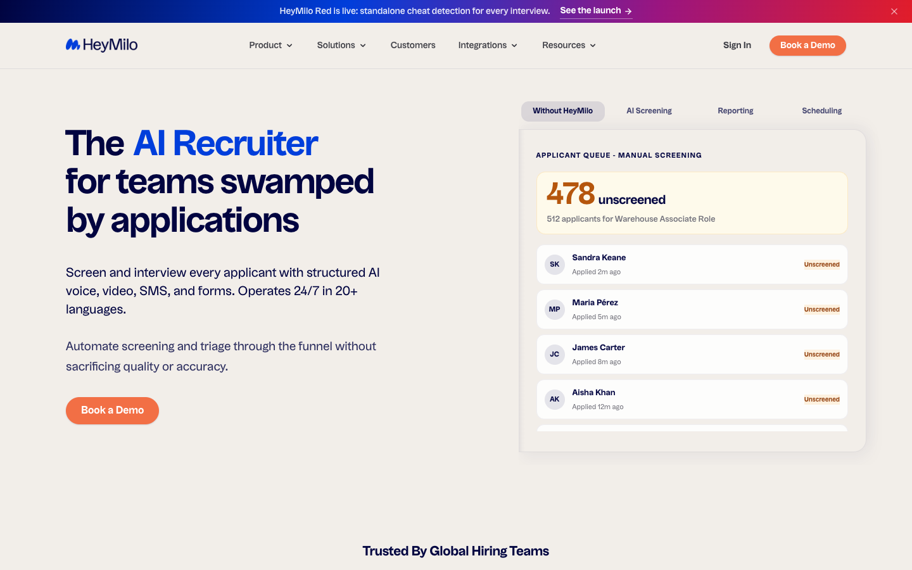
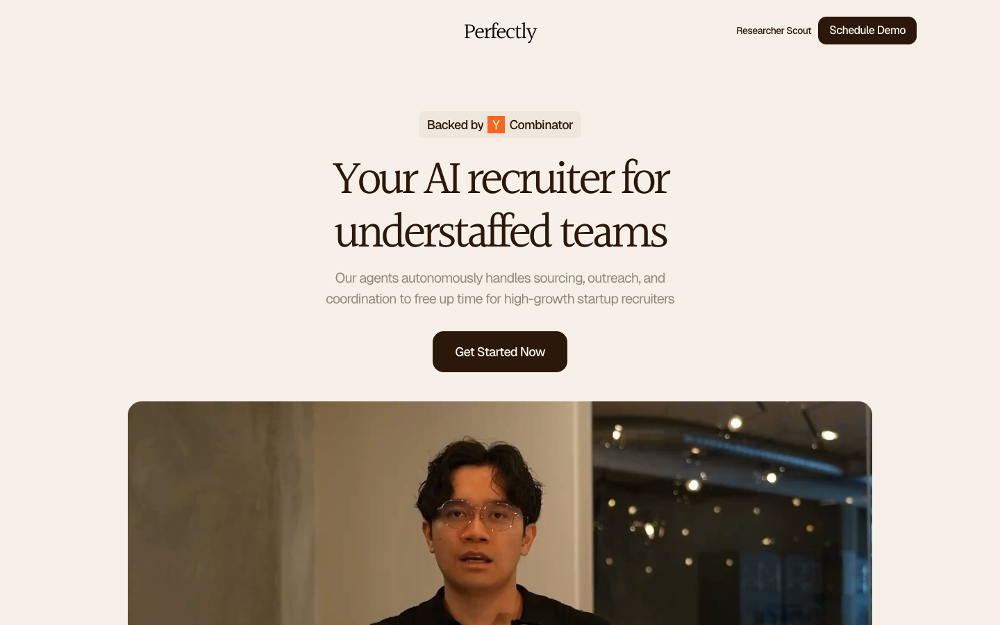

# iHiring: design research and recommended direction

Research date: 6 October 2026. Status: researched proposal for discussion, not an approved design system.

## 1. The recommendation

Build a **calm, product-led, editorial website with a contemporary Indian sensibility**. Pair warm paper-like surfaces and distinctive display typography with precise, readable product UI. Let a real hiring journey carry the page: an applicant enters, SAM conducts a conversation, and a hiring team receives evidence it can review.

Working concept: **Talent, in focus.**

The intended impression is: “This team understands people, has built serious technology, and respects my time.” Indian identity should emerge through the typography's provenance, material-like colors, authentic people and company story, rather than requiring visitors to decode ornamental symbols.

The three reference roles:

- **Sarvam:** coherent cultural identity and the transition from brand promise to an inspectable product.
- **Alex:** human warmth and clear buyer-oriented communication.
- **HeyMilo:** visible workflow, tangible reports, and concrete explanations of what recruiters receive.

These are design interpretations. We have no conversion or usability data establishing that their sites perform better.

## 2. What iHiring currently does

### Publicly described product

[iHiring](https://ihiring.ai/) markets SAM as an AI interviewer within a wider recruiting workflow:

1. Screen resumes and manage candidates entering the pipeline.
2. Automate scheduling and rescheduling, with 24/7 availability.
3. Conduct AI interviews. The existing demonstration shows candidate video alongside live transcripts.
4. Provide post-interview reports and candidate insights.
5. Offer interview proctoring / cheating-detection capabilities.
6. Connect with an existing ATS or iHiring's own pipeline tooling.

The site explicitly addresses staffing and enterprise use, and describes teams of different sizes. Its metadata adds technical skills, soft skills, personality and cultural fit to the positioning. The visible technical-role examples do not establish that the product is exclusively for engineers.

**Useful category description:** “AI interviewing and screening for hiring teams.”

**Proposed plain-language explanation:** “SAM screens applicants, schedules and conducts interviews, and gives your team reports to review.”

“Source” appears in the site diagram. That does not establish an autonomous outbound sourcing product or a proprietary candidate network. Show candidate intake unless the team can demonstrate more.

### Positioning today

- Hero: “Meet Sam! The Only AI Interviewer That Thinks Beyond Intelligence.”
- Benefit deeper down: “Vet Qualified Candidates in Minutes, Not Weeks.”
- Conversion: get a demo, with no public pricing table observed.
- Proof: candidate testimonials, links to review platforms, and a 7.4x productivity claim.
- Integration names are present in the site's existing FAQ/configuration. Their precise implementation and availability need confirmation before creating new integration pages.

The central communication problem is **a concrete product presented through an abstract headline**. SAM's name is useful, but new visitors first need to understand the task it performs and why they should care.

### Existing project context

The workspace already contains a Next.js redesign and earlier reference research. `PLAN.md` records founder-first positioning, HR/talent leads as a secondary audience, and demo-led conversion. Those are prior project decisions, not conclusions independently proved by the public site.

Use founder-first as the starting hypothesis for design exploration. Confirm it against actual customers before finalizing copy. A founder-first site and a staffing-first site can share a visual system, but their heroes, proof and use-case pages should differ.

## 3. Current-site findings

Behavioral outcome: **When a founder or hiring lead evaluates iHiring, they can understand what SAM handles, inspect the resulting report, and judge whether it fits their hiring workflow without deciphering AI marketing language.**

| Priority | Observed issue | Behavior at risk | Recommended change |
|---|---|---|---|
| High | The largest heading introduces SAM; the category and benefit are secondary. | A first-time buyer may remember the character without understanding the offer. | Give the buyer outcome the H1, identify SAM in the supporting sentence. |
| High | “Thinks Beyond Intelligence” is not explained through a concrete example in the hero. | Visitors must infer what is different. | Show a follow-up question and the resulting report evidence. |
| High | “The Only AI Interviewer” appears while multiple researched products sell AI interviewing. | The exclusivity claim may undermine credibility. | Replace it with a specific, supportable capability. |
| High | The strongest visible quotes come from candidates rather than purchasing teams. | Candidate comfort may be mistaken for proof of business impact. | Keep candidate evidence, add buyer evidence when available, label each clearly. |
| Medium | Nav labels include “Features,” “Actionable Insights,” and “Functionality.” | Visitors must guess where product information lives. | Use Product, How it works, Who it's for, Resources. |
| Medium | Pricing links to contact rather than showing prices. | A visitor's expectation is broken at the click. | Use “Contact sales” or a genuine pricing explanation. |
| Medium | The current video is a large interview recording with tiny transcript content. | Viewers can see a conversation but struggle to inspect the value on mobile. | Use a readable product crop and an optional recording. |
| Medium | Purple/pink gradient display text, electric blue accents, dark teal text and changing section treatments compete. | The page can feel assembled from effects rather than one brand idea. | Establish a consistent base, one action color and a limited supporting accent. |
| Medium | Current mobile CTA says “See ihiring.” | Visitors cannot predict whether they will watch, explore or submit a form. | Use “Watch a SAM interview” or “Book a demo,” matching the destination. |

These behavioral risks are hypotheses based on inspected content and layout, not observed user failures. Test them before treating them as settled.

### Strengths to preserve

- A working-product demonstration is already available.
- SAM provides a memorable name for the interviewer.
- The screening-to-report workflow is understandable when described plainly.
- Candidate quotes address professionalism, convenience and interview anxiety.
- Scheduling and ATS compatibility answer practical adoption concerns.

## 4. Research method and evidence

Nine sites were opened in Chromium: iHiring, Sarvam, Alex, HeyMilo, Humanly, Hirevue, BarRaiser, Intervue and Perfectly. For each, captures include a 1440 × 900 desktop hero, two lower scroll positions, and a 390 × 844 mobile hero. Computed typography, color samples, media elements and available animation metadata are in `observations.json`.

This is a public marketing-site inspection. It is not a logged-in product evaluation, full-site functional QA, frame-by-frame motion audit, or conversion benchmark. Cookie notices remain in some captures to preserve the actual first-visit experience. Lazy loading and animation timing can affect a captured state.

The browse daemon could not launch its expected Chromium version, so the capture script reused an already installed Chromium through Playwright. Reproduction script: `scripts/design-research.mjs`; optional `PLAYWRIGHT_MODULE` and `CHROMIUM_PATH` overrides are supported.

### Competitor/reference map

| Site | Relationship to iHiring | Positioning observed | Visual language | Elements / motion observed | What to learn |
|---|---|---|---|---|---|
| [Alex](https://www.alex.com/) / Apriora | Direct AI-interviewing and recruiting competitor | “Interview everyone. Hire the best.” | DM Sans; light weights; pale green/cream surfaces and dark green text; cinematic people imagery. | Background video, translucent conversational messages, alternating human-image/product explanations, buyer stories and separate candidate proof. | AI can feel human without a robot mascot. Name the buyer outcome, then explain the mechanism. |
| [HeyMilo](https://www.heymilo.ai/) | Direct workflow competitor | AI recruiter for teams swamped by applications. | Uxum; strong navy headings; warm neutral background; blue emphasis and orange CTAs. | Hero stages for manual queue, screening, reporting and scheduling; product-like lists, transcripts, score reasoning, before/after comparisons and moving elements. | Make the before, process and deliverable inspectable rather than describing everything with icons. |
| [Humanly](https://www.humanly.io/) | Direct/overlapping AI recruiter and interviewer | High-volume/frontline hiring. | Large sans display; Work Sans body; electric blue, navy and pale lavender; people photography. | Rotating outcome headline, demo/trial-interview actions, explanatory media, clear problem section, buyer stories and ROI calculator. | Connect hiring delays to a buyer's daily work. An accessible product experience can precede a sales call. |
| [Hirevue](https://www.hirevue.com/) | Enterprise AI interviewing/assessment competitor | Confident talent decisions, supported by hiring science. | Outfit; white and cool-gray surfaces; charcoal; pink and purple emphasis. | Report/AI-interviewer composition, product tour, numbered story chapters, customer-result cards, governance section. Loaded scripts expose GSAP/ScrollTrigger. | Quality and confidence need visible evidence, not only speed claims. Tours and sample artifacts help. |
| [BarRaiser](https://www.barraiser.com/) | Adjacent human-expert interview outsourcing and AI-assisted evaluation | Give engineering teams their time back. | Manrope headline; Inter in other areas; white, navy, blue/purple gradients; prominent video. | Three-step explanation, timing labels, outcome metrics, customer and candidate evidence, comparison section. | Explain who does the work and what comes back. Do not conflate expert-human interviews with autonomous AI interviews. |
| [Intervue](https://www.intervue.io/) | Adjacent interview outsourcing; also advertises AI screening | Save engineering bandwidth. | Primarily black/white with blue emphasis; straightforward split layout and rectangular CTAs. | Explicit organization/candidate/interviewer routes, layered interview-video windows, solution tabs and case studies. | Separate audiences and connect the service to engineering capacity. |
| [Perfectly](https://www.perfectly.so/) | Adjacent AI recruiting/sourcing agency, not an equivalent interviewer | AI recruiter for understaffed startup teams. | Halant display serif, warm cream/brown palette, restrained sans supporting text. | Simple centered hero, founder video, numbered sourcing/outreach process and success narrative. | Warm editorial typography is viable in recruiting. Do not import sourcing-agency promises into iHiring. |
| [Sarvam](https://www.sarvam.ai/) | Cultural/visual reference, not a recruiting competitor | “AI for all from India.” | Season Mix display; Matter body; Matter Semi Mono labels; light surfaces; blue-to-orange gradient fields. | Motif, editorial hero, product playground, API/code examples, geometric product forms, enterprise proof and Indian customer stories. | A cultural concept can unify an entire system while product demonstrations establish substance. |

### Additional screening

[micro1](https://www.micro1.ai/) was checked. Its current homepage leads with frontier-model data and agent evaluation, rather than an AI hiring product. It should not be presented as a like-for-like homepage benchmark today. Earlier project references include Candidately, Contrario and Prism; those are useful supporting material but not freshly browser-audited in this pass.

### Visual reference gallery

Current iHiring:

Sarvam's brand expression and product proof:

Alex's human expression:

HeyMilo's workflow expression:

Perfectly's editorial expression:

## 5. What Sarvam teaches us about Indian identity

Sarvam's [published brand story](https://www.sarvam.ai/brand) explains its gateway concept, exploration across regional references, circle-based/mandala construction, lotus-like monogram and blue-to-orange spectrum. Its rationale explicitly seeks a grounded, modern identity without nostalgia or symbolism for its own sake.

In the inspected website, this becomes a coherent combination of a serif-led headline, a small motif, generous space, controlled color, and a real product playground. The cultural story is reinforced by product capabilities and actual India-focused examples.

For iHiring, use that **method**: begin with a relevant idea and translate it consistently into typography, composition, imagery, copy and interaction.

An India-rooted identity can be built through:

- Type designed by Indian studios, selected for readability and character.
- Cotton/paper-like neutral backgrounds, ink-like indigo and a sparing copper accent.
- Original photography of real founders, hiring teams and candidates in contemporary settings.
- A specific, factual origin story and portraits of the actual team.
- A small composition rule inspired by framing, rhythm or paired conversation turns.

Color and type provenance alone will not reliably communicate “Indian” to every visitor. Test that perception. English-language buyers should never need to recognize a script or symbol to understand the product.

India-founded, India-operated, Indian-language support, Indian data residency, and sovereign AI are different claims. The public iHiring pages inspected do not establish those claims. Confirm the relevant facts before using “Built in India,” regional-language examples or a domestic-infrastructure story.

## 6. Three art directions

### A. Talent, in focus — recommended

**Personality:** thoughtful, warm, precise, quietly ambitious.

**System:** warm ivory, ink indigo, white product surfaces, copper used sparingly. Halant display headings paired with a crisp sans for content and product UI. Two offset open frames form a simple composition device: one represents the conversation, the other the hiring team's view of the evidence. The framing device appears in image crops, section composition and report previews; it is not an ornamental animation.

**Human layer:** a real candidate image, short transcript, and readable report details.

**Motion:** user-controlled product stages; short crossfades and local state changes. The page's strongest moment is a conversation becoming a useful report.

**Why it fits:** feels distinct from the familiar purple-glow AI template while retaining enough product precision for a serious B2B purchase.

**Risk:** it could become too literary or resemble a recruiting consultancy if the product is delayed. Put product evidence within the first viewport or immediately below it. Halant's use by Perfectly is a reason to differentiate composition, palette and imagery, not reproduce that site.

### B. Clear signal

**Personality:** practical, exact, operational.

**System:** white/cool neutral, deep navy and the existing iHiring blue; a humanist sans-led hierarchy such as Mukta for brand text, with precise product UI. Information-rich split hero, visible report and compact workflow.

**India expression:** authentic people, provenance and company story rather than a serif/motif.

**Why consider it:** directly challenges the assumption that the brand needs editorial typography. It may suit enterprise or staffing buyers who prefer rapid inspection of capabilities.

**Risk:** it could blend into HR SaaS competitors. Give it a distinctive framing system and strong original content.

### C. Conversations create opportunity

**Personality:** human, confident, approachable.

**System:** large original people imagery, warm stone, dark ink and limited blue. A clear sans headline with an editorial quote style. Transcript overlays link the people to SAM's work.

**India expression:** contemporary Indian professionals photographed with specificity, alongside the actual team story.

**Why consider it:** stronger when candidate comfort and trust are the key differentiators.

**Risk:** looks like a staffing agency without prominent product proof; requires excellent original photography. Avoid a full-screen autoplay video that hides what the product does.

**Recommendation:** develop A as the primary concept and B as a contrasting control. Choose using buyer comprehension and product credibility as well as visual preference.

## 7. Proposed visual system for direction A

These are candidate tokens to prototype, not Sarvam's extracted colors or final approved tokens.

| Role | Proposed value | Use |
|---|---|---|
| Paper | `#F7F4EE` | Main brand canvas, warm but nearly neutral. |
| Ink | `#202738` | Body text and primary structure. |
| Indigo | `#303F78` | Primary actions, selected stages and links. |
| Copper | `#A65336` | Small editorial accents or highlighted narrative moments. |
| White | `#FFFFFF` | Report and product surfaces. |
| Muted text | `#596173` | Supporting copy. |
| Hairline | `#DDD9D2` | Non-critical dividers; stronger border for controls when needed. |

Use opaque surfaces under important text. Indigo should consistently mean action or selection. Copper should not become a second competing CTA color. Status uses a separate semantic palette and text labels. Verify contrast on every actual foreground/background pair.

### Typography

- **Display candidate:** Halant 400/500, primarily hero and large section headlines. Its [published description](https://raw.githubusercontent.com/google/fonts/main/ofl/halant/DESCRIPTION.en_us.html) confirms Latin/Devanagari support and Indian Type Foundry provenance. This is a factual provenance link, not a claim that all viewers will perceive the font as Indian.
- **Body/UI candidate:** a precise sans such as Geist; prototype Mukta as a more culturally connected alternative. [Mukta's description](https://raw.githubusercontent.com/google/fonts/main/ofl/mukta/DESCRIPTION.en_us.html) identifies Mumbai-based Ek Type and its multi-script project. Script support requires the relevant family, e.g. Mukta Malar for Tamil, not the assumption that one font file covers every Indian language.
- Keep reports, buttons, form fields and small labels in the sans. Do not use a decorative display face for controls.
- Hero: approximately 64–76px desktop / 38–44px mobile, adjusted to the selected face. H2: 36–44px / 28–32px. Body: 17–18px. These become responsive `rem`/`clamp()` values in implementation.
- Use script-specific leading. Do not apply Latin negative tracking to Indic text.
- Sarvam uses Season Mix and Matter in the inspected page, not a verified “Masakali” font. The precise Masakali typeface the user has in mind remains unidentified; get its specimen/source before choosing it.

### Layout and components

- Content width around 1200px; 12-column desktop grid; 20–24px mobile gutters.
- A restrained spacing scale: 4, 8, 12, 16, 24, 32, 48, 64, 96; use responsive units where text scales.
- 88–120px between major desktop chapters, 48–64px on mobile, adjusted to content rather than enforced as empty space.
- Product panels with 16–20px radii; buttons approximately 10–12px. Use hierarchy, not a different radius for each section.
- Solid primary button, quiet secondary button/link, consistent labels and visible focus.
- Reuse named components: SectionIntro, ProductStage, TranscriptExcerpt, ReportPreview, EvidenceQuote, IntegrationList, FAQItem, DemoForm.
- Use a product demonstration, one editorial split section, a readable workflow, and an evidence section. A whole page of identical bento cards will weaken the story.

## 8. The website's story, section by section

Narrative: **Hiring consumes attention → SAM handles repeatable work → conversations produce evidence → your team can decide → the workflow fits → next step.**

| Chapter | Visitor's question | Proposed content | Visual behavior |
|---|---|---|---|
| 1. Promise | What is this, and is it for me? | Category, outcome headline, one-sentence product explanation, demo + watch actions. | Product preview with a person, readable conversation and report excerpt. |
| 2. Problem | Why should I change my current process? | Applicant review, coordination and repeated first-round conversations compete for team time. | Compact everyday-work example. No invented time-saving totals. |
| 3. Mechanism | What exactly does SAM handle? | Intake/screen → schedule → interview → report. | One candidate/role carried through four selectable stages. |
| 4. Differentiation | Is this just a scripted questionnaire? | Demonstrate a real follow-up and how context appears in the report, if supported by the product. | Short, readable transcript beside the related report finding. |
| 5. Deliverable | What do I receive? | Sample of the actual report, with explanation of available evidence and limits. | Large inspectable report, not a tiny dashboard screenshot. |
| 6. Fit | Can my team use this? | Founder-first example, then HR/staffing examples consistent with actual customers. | Brief use-case narratives; no mandatory tab interaction to understand them. |
| 7. Adoption | Does this work with my stack? | Confirmed ATS integrations, setup path and what moves between systems. | Static integrations + an intelligible input/output example. |
| 8. Trust | Will candidates and my team trust the process? | Buyer quote/case when available; candidate experience; clear human decision boundary; factual data handling. | Quiet evidence section with named sources. |
| 9. Questions | What might block adoption? | Roles supported, questions/rubrics, report timing, setup, ATS, candidate requirements and data questions. | Accessible accordion; essential explanation outside collapsed UI. |
| 10. Invitation | What happens if I request a demo? | A concise invitation and truthful description of the next step. | Same CTA wording, small form or booking page, explicit confirmation. |

### Hero copy to prototype

Eyebrow: **AI interviewing for hiring teams**

Headline: **Less time screening. More time meeting the right people.**

Support: **SAM screens applicants, schedules and conducts interviews, and delivers reports for your team to review.**

Primary: **Book a demo**

Secondary: **Watch a SAM interview**

Optional brand/origin line lower in the page: **Built in India. Designed for every opportunity.** Only after confirming the origin claim. It should not substitute for the product explanation.

Founder-first variant to test: **Build your company. Let SAM handle the first interviews.** This requires confirmation that first-round interviewing matches the normal deployment.

Avoid a one-week hiring promise unless customer evidence supports it. Interview automation does not establish that an employer can complete its full hiring process in that period.

### Hero composition

Desktop: left 5 columns for category, two-line headline, explanation and actions; right 7 columns for an honest product preview. Warm background; a fine frame or divider provides identity without obscuring the UI. Under the preview, a compact “Screen → Schedule → Interview → Report” sequence explains scope.

Mobile: category, headline, explanation and actions before the preview. Show one readable product state at a time, with clear controls to inspect the next. Preserve important evidence in text outside media. Do not shrink a desktop dashboard until all its content is unreadable.

### The signature product moment

Use a representative role and a clearly labeled example candidate. A visitor selects “Interview” and sees a short SAM conversation; selecting “Report” reveals the corresponding deliverable. Keep the same person, role and answer content across both views so the connection is obvious.

Map the design to actual report fields. Candidate score breakdown, cited transcript excerpts, recording timestamps and export controls are possible preview patterns, not verified iHiring capabilities. Show them only if the real product provides them. Label illustrative data explicitly.

## 9. Motion and Apple design guidance

The user's requested Apple skill was not installed locally under that name. Search found [Emil Kowalski's apple-design](https://skills.sh/emilkowalski/skills/apple-design), and its [full source guidance](https://github.com/emilkowalski/skills/blob/main/skills/apple-design/SKILL.md) was read for this proposal. Another similarly named package exists, so confirm the intended source before installing for implementation.

Apply the guidance to interface behavior:

- Press feedback begins immediately; a click commits the action.
- Tabs and panels remain responsive if a user changes their mind mid-transition.
- Menus open near their triggers and close along the same spatial path.
- A product-stage transition preserves context instead of moving unrelated cards across the screen.
- Default springs settle without visible bounce; physics are useful only where the interaction calls for them.
- Prefer short opacity/transform transitions for local feedback; do not delay content until an entrance animation completes.
- Use appropriate typography tracking/leading, clear grouping and precise labels.
- Respect reduced motion, text zoom and reduced transparency; preserve feedback with static changes or short fades.

For this page, the motion budget is deliberately small:

| Interaction | Proposed treatment | Purpose |
|---|---|---|
| Button press | Immediate local emphasis / slight compression | Confirms input. |
| Product stage change | Roughly 180–280ms crossfade or a restrained interruptible spring | Explains a state change. |
| Transcript playback | User-started, short excerpt, pause/skip controls | Demonstrates the conversation. |
| Report reveal | A single local highlight corresponding to an answer | Links input to output. |
| FAQ / navigation | Fast, reversible expansion | Supports wayfinding. |

Use normal scrolling. Avoid a forced pinned cinematic sequence, full-viewport animated backgrounds, mandatory auto-rotating product tabs, typing delays for essential copy, or animation on every card. A static view should communicate the entire proposition.

Apple's interaction guidance supplies craft. iHiring's cultural story supplies identity. Surface effects such as glass are optional and should earn their place through legibility and function.

## 10. Product design psychology: assumptions and validation

The [Product Design Psychology](https://productdesignpsychology.com/) skill was used to evaluate comprehension, immediate value, predictable actions, cultural context and decision confidence. Psychology identifies risks; it does not validate an aesthetic by itself.

### Test A: can a stranger understand the business?

- Hypothesis: a buyer-outcome hero with a concrete SAM explanation improves category and next-action comprehension.
- Method: show current and proposed heroes for five seconds to separate first-time participants, then hide them. Ask “What does this company do?”, “Who would use it?” and “What would you do next?”
- Participants: actual target founders/hiring leads; include India-based and international buyers if both markets matter.
- Decision rule: as an initial qualitative gate, at least 4 of 5 in each relevant buyer group should correctly describe AI interviewing/screening and the intended next action. Revise if the redesign makes people infer a job board or human recruitment agency. This small sample is a usability gate, not statistical proof.
- Guardrail: they must also understand that the employer reviews the output and makes the hiring decision, if that is the real product model.

### Test B: does the report establish confidence?

- Hypothesis: visible, job-relevant evidence improves understanding more than an unexplained AI score.
- Method: give a clickable, realistic report preview. Ask the participant to explain what they know about the candidate, what they do not know, and what they would check next.
- Decision rule: keep the layout when participants can locate the actual basis for findings without coaching; revise if the visual implies certainty unsupported by the data.
- Guardrail: a higher demo click rate must not come from misunderstanding how scoring works.

### Test C: does the cultural direction help the brand?

- Hypothesis: warm type/color and authentic company imagery communicate a contemporary, India-rooted technology company without weakening product credibility.
- Method: compare A and B using identical copy and product content. Ask for first impressions before mentioning India, then probe the cues that produced them. Do not ask “Does this feel Indian?” at the start.
- Decision rule: favor the direction that retains category comprehension, earns credible/modern associations and avoids repeated confusion with an agency or cultural/lifestyle brand. Cultural recognition alone is insufficient.
- Guardrail: readability, accessibility and international comprehension should remain strong.

### Test D: is the conversion path predictable?

- Hypothesis: an ungated example and a clearly named demo action reduce commitment before perceived value.
- Method: observe participants inspecting the demo/report and attempting to contact the team.
- Decision rule: revise any point where participants cannot predict the destination, cannot recover from errors, or miss the completion state.
- Guardrail: measure qualified requests and sales-call fit, not raw clicks alone.

## 11. Content and SEO foundations, reserved for the next discussion

Design the content architecture now, do keyword strategy after audience and product positioning are confirmed.

- Give the homepage an explicit AI-interviewing category and one H1; use descriptive section headings.
- Plan product detail, how-it-works, integrations, genuine customer stories, company and demo pages.
- Separate candidate help/interview tips from employer-facing resources. The current blog route is candidate-oriented.
- Investigate buyer topics such as AI interviewer, automated screening interviews, structured interview reports, ATS interview automation and startup hiring workflow. These are research themes, not validated keyword targets or volume estimates.
- Use-case pages need distinct examples and actual buyer questions; avoid thin keyword-swapped pages.
- Keep important explanatory copy in crawlable text, not only in video/canvas/animated visuals.
- Confirm redirects for existing URLs. Preserve candidate-help routes and privacy links.
- Existing project audit flags an OG image mismatch, generic manifest name, disabled zoom and repeated subpage titles. Recheck against the live implementation when building; these are inherited findings, not a fresh technical SEO audit.

## 12. What must be confirmed before mockups become final

1. **Main buyer and sales evidence:** founders, staffing agencies, or enterprise talent teams? Which segment already pays and renews?
2. **Company identity:** is India-founded/India-built an accurate origin story, and how prominent should it be internationally?
3. **Product evidence:** current SAM recording and report, representative questions, actual rubric/report fields, and supported roles.
4. **Differentiation:** what can iHiring demonstrate that a generic AI interviewer cannot? Follow-up quality, customization, deployment effort and integration depth are hypotheses to examine.
5. **Proof:** approved buyer quote/case study and the basis of the 7.4x claim. Existing candidate quotes remain useful when clearly attributed.
6. **Fonts/skills:** identify the requested Masakali specimen and confirm which Apple design skill source to use during the build.
7. **Conversion:** demo destination, response expectations and minimal required lead fields.

Recommended next artifact: **two desktop/mobile hero-and-product-section concepts, A and B, using identical truthful copy and the same SAM/report example**. Review the complete opening story rather than choosing a font or palette in isolation. Then formalize the selected system in `DESIGN.md` and carry it across the page.

## 13. Sources

- [iHiring homepage](https://ihiring.ai/)
- [Alex homepage](https://www.alex.com/)
- [HeyMilo homepage](https://www.heymilo.ai/)
- [Humanly homepage](https://www.humanly.io/)
- [Hirevue homepage](https://www.hirevue.com/)
- [BarRaiser homepage](https://www.barraiser.com/)
- [Intervue homepage](https://www.intervue.io/)
- [Perfectly homepage](https://www.perfectly.so/)
- [Sarvam homepage](https://www.sarvam.ai/), [brand story](https://www.sarvam.ai/brand), [brand guidelines](https://www.sarvam.ai/brand-guidelines)
- [micro1 homepage, screened for relevance](https://www.micro1.ai/)
- [Halant font description](https://raw.githubusercontent.com/google/fonts/main/ofl/halant/DESCRIPTION.en_us.html)
- [Mukta font description](https://raw.githubusercontent.com/google/fonts/main/ofl/mukta/DESCRIPTION.en_us.html)
- [Apple design skill](https://github.com/emilkowalski/skills/blob/main/skills/apple-design/SKILL.md)
- [Product Design Psychology](https://productdesignpsychology.com/)
- Local prior context: `PLAN.md`, `site.config.json`, `research/summary.json`, `web/app/page.tsx`.
- Fresh captures and measured style metadata: this directory's PNG files and `observations.json`.
